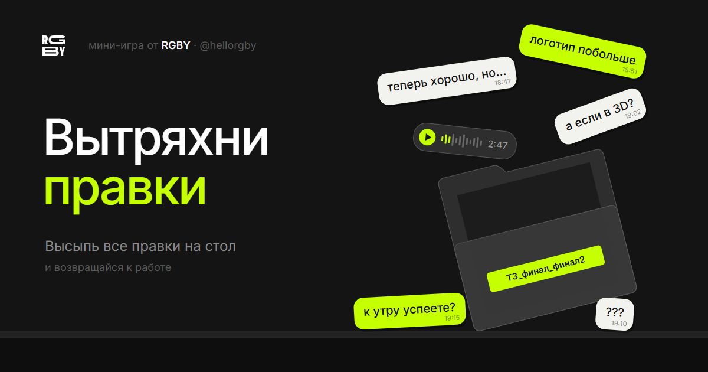

# Вытряхни правки

Мини-игра от креативного агентства [RGBY](https://t.me/hellorgby).

В папку с ТЗ прилетают сообщения от клиента. Хватай папку, переворачивай и тряси, пока все правки не окажутся на столе. Последняя держится крепче остальных: «теперь хорошо, но…»

**Играть:** https://vynepravy.github.io/pravki/

## Как устроено

- Один HTML-файл без сборки: canvas и физика на [Matter.js](https://brm.io/matter-js/) (лицензия MIT).
- Рекорды хранятся только в браузере игрока, на сервер ничего не отправляется.
- Работает на телефоне и компьютере.

---

ООО «РГБИ» · креативное агентство с собственным CG-продакшном
[@hellorgby](https://t.me/hellorgby) · hello@rgby.ru · 8 804 700 73 70 · Artplay, Москва
